# Test Menu Moon

[](https://github.com/moonlivedt-oss/TestMenuMoon/actions/workflows/tests.yml)


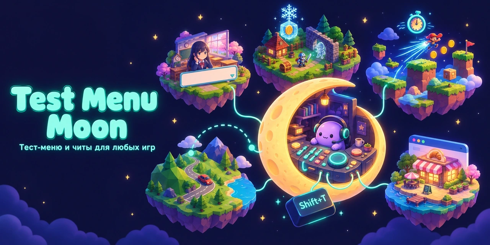

Тест-меню и читы для игр любого жанра. Ставится в игру одной кнопкой, открывается в игре
по **Shift+T** (запасная — **F9**): правка переменных, заморозка, поиск значений как в ArtMoney,
скорость игры, шаг кадра и счётчик FPS, телепорт, подсказки к выборам, авто-прохождение для
тестеров. Плюс студия на PyQt6: библиотека игр (вся папка с играми разом) и редактор сохранений.

| Движок | Что ставится | Меню в игре |
|---|---|---|
| **Ren'Py** 6.99 – 8.x (py2 и py3) | `.rpy`-файлы в `game/` | самое полное: 7 вкладок, подсказки к выборам, авто-прохождение |
| **RPG Maker MV / MZ** | плагин `js/plugins/TM_Menu.js` | значения, отряд, режимы, карты, «кто меняет переключатель» |
| **HTML5** (Phaser, Construct 2, GDevelop, свои движки) | блок `<script>` в `index.html` | значения, скорость, шаг кадра, сканер, сейвы localStorage / IndexedDB |
| **Twine / SugarCube** | блок `<script>` в истории | переменные истории, сканер |
| **Godot 4** | автозагрузка через `override.cfg` | переменные, Dialogic, скорость, телепорт |
| **Unity IL2CPP** | BepInEx 6 + UnityExplorer + плагин | поля объектов, заморозка, скорость, телепорт |
| **Unity Mono** (x64 и x86) | BepInEx 5 + UnityExplorer + плагин, собранный под игру | то же |
| **Unreal Engine 4 / 5** | UE4SS + Lua-мод | клавиши: скорость, бессмертие, полёт, телепорт; Live View |

Игра и её архивы не меняются: всё, что положено, снимается одной кнопкой (`--remove`).

> Для одиночных игр. В онлайн-игры с античитом (EasyAntiCheat, BattlEye и т.п.) установщик
> ничего не ставит — за это банят.

## Скриншоты

Тестовая новелла «Moonlight Academy» (фон и персонаж — из демо-игры The Question из Ren'Py SDK).

| Подсказки к выборам (видно и скрытый вариант) | Переменные с понятными именами |
|---|---|
| 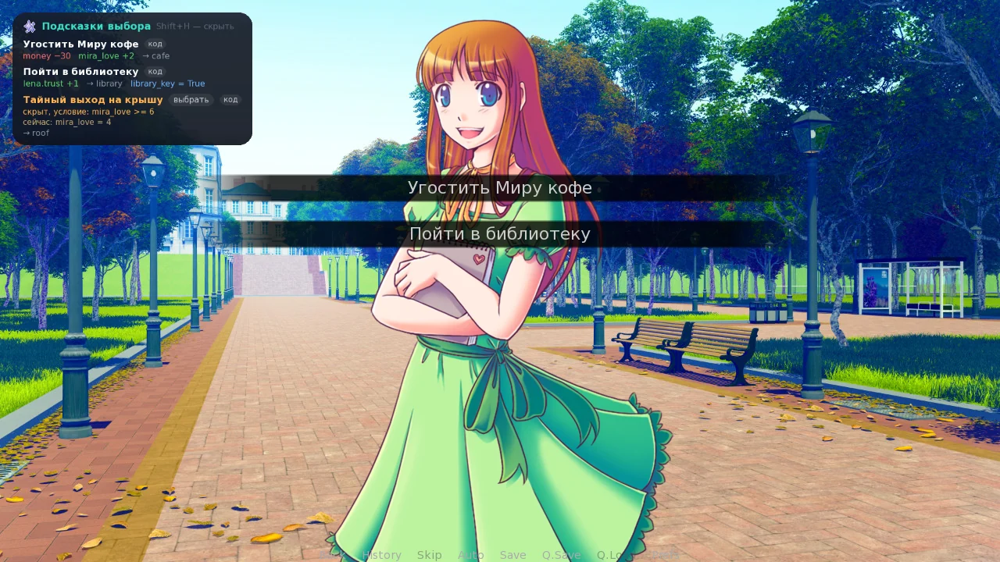 | 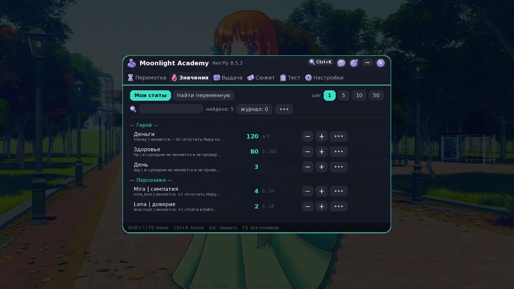 |
| **Сюжет**: подсказки, история выборов, кнопки на экране | **Тест**: авто-прохождение и маршруты |
| 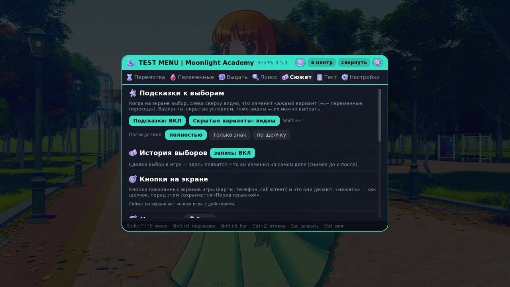 | 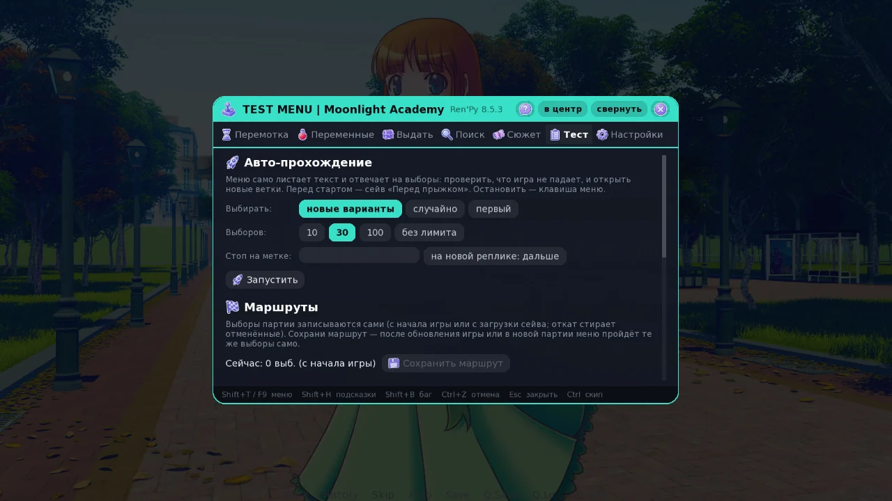 |
| **Перемотка**: откат, быстрые слоты, скип | **Настройки** |
| 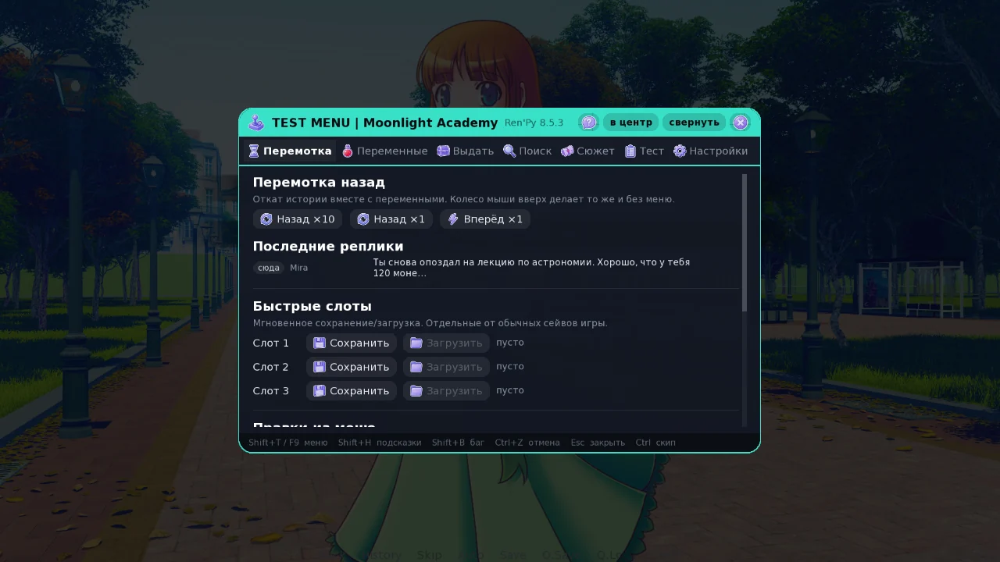 | 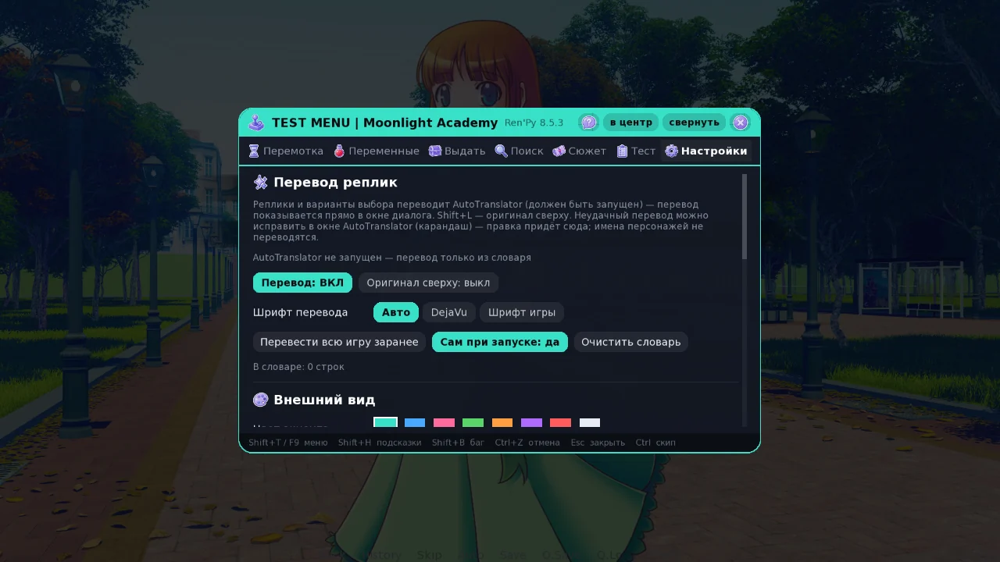 |

RPG Maker («Star Harbor») и HTML5-игра («Pixel Bakery»):

| RPG Maker: значения и «где» | RPG Maker: вкладка «Игра» |
|---|---|
| 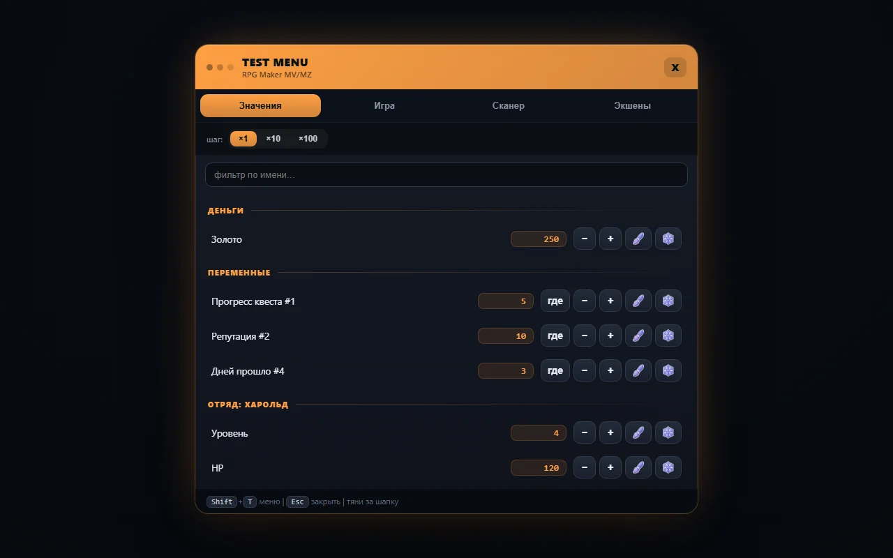 | 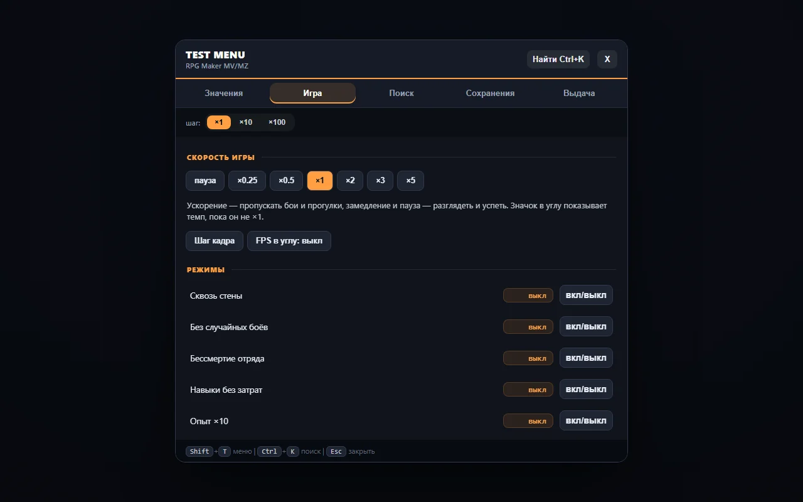 |
| **HTML5**: найденные переменные игры | **HTML5**: скорость, профиль |
| 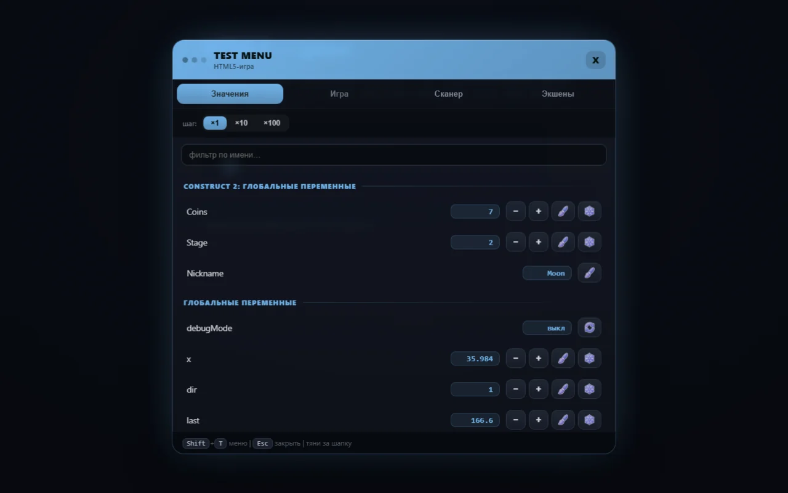 | 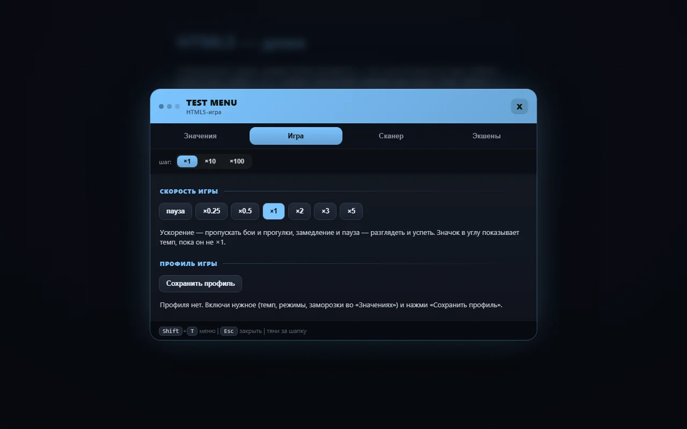 |

Студия и редактор сохранений:

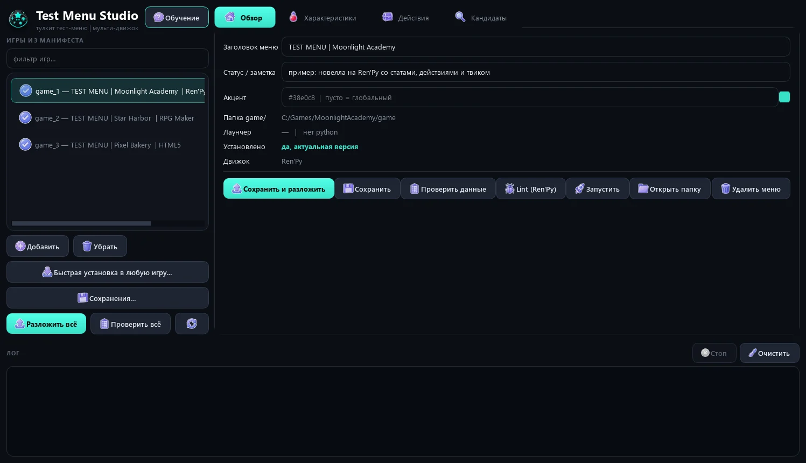
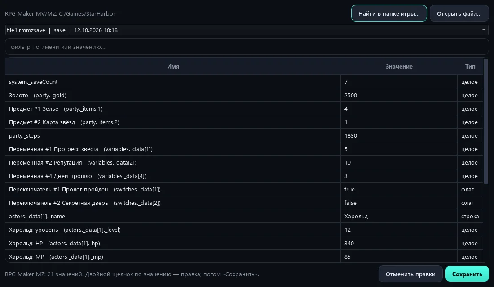

## Быстрый старт

```
pip install -r requirements.txt     # PyQt6 — только для студии
python studio.py                    # или Запуск.bat
```

В студии: **«Быстрая установка в любую игру…»** → выбрать папку игры → запустить игру → **Shift+T**.
Движок определяется сам. Если игр много — **«Библиотека игр…»**: указать папку, студия найдёт
все игры, покажет движок и состояние меню (нет / устарело / актуальное) и поставит, обновит или
снимет меню у отмеченных разом. То же из консоли:

```
python tm.py quick "C:/Games/SomeGame"            # папка игры, её game/ или .exe
python tm.py quick --remove "C:/Games/SomeGame"
python tm.py library "C:/Games"                   # все игры в папке: движок и статус
python tm.py library "C:/Games" --install         # поставить, где нет или устарело
```

При первом запуске студия показывает обучение (повторить — кнопка «Обучение»). В игре кнопка со
знаком вопроса в шапке меню — «Как пользоваться меню».

Для Unity и Unreal загрузчики модов скачиваются один раз: `python tools/fetch_unity_tools.py`
(BepInEx 5/6, UnityExplorer, UE4SS, AssetRipper, Cpp2IL — в `tools/unity/`, в git не идут).

## Ren'Py: что умеет меню

- **Перемотка** — откат истории (×1/×10, колесом), 3 быстрых слота, мгновенный скип (в т.ч.
  непрочитанного), авто-пропуск, скорость текста; перед прыжком меню само сохраняет слот
  «Перед прыжком»; лог последних реплик с откатом к любой.
- **Переменные** — правка статов (−/+ с шагом, ввод, `+50`, `*2`, `=-5`), тумблеры, заморозка
  (`=`, `≥`, `≤`), избранное, HUD поверх игры, отметки «изменилось с прошлого раза», отмена правок
  (Ctrl+Z). Источники: **data** (список из манифеста) и **авто** — меню само находит переменные
  игры, объекты классов, словари и списки. Понятные имена: `alice_love` → «Alice | Симпатия»
  (имя персонажа + словарь слов + подписи из реплик), серая строка — где значение меняется и
  какие пороги проверяет сценарий.
- **Выдать / Код** — действия из манифеста (предметы, деньги) и свой Python-код.
- **Поиск** — как ArtMoney, но по именам переменных: снимок → изменения → сужение.
- **Сюжет** — подсказки к выборам (**Shift+H**: что изменит каждый вариант, скрытые условием
  варианты и кнопка «выбрать», код варианта), история выборов с реальными изменениями, кнопки
  экранов игры, переход к метке и поиск реплики, повтор сцены, «Где я», галерея и `persistent`.
- **Тест** — авто-прохождение (новые варианты / случайно / первый, сторож «игра ждёт игрока»),
  маршруты (запись выборов и повтор после обновления игры), покрытие реплик и сцен, непросмотренные
  сцены и «откуда в них попадают», заметка о баге (**Shift+B**: текст + место + скриншот).
- **Настройки** — оформление, HUD, клавиша меню, отчёт тестера, «Убрать следы меню».
- **Профиль игры** — кнопка «в профиль» у заморозок: они ставятся сами при каждом запуске.
- Перевод реплик через [AutoTranslatorMoon](https://github.com/moonlivedt-oss/AutoTranslatorMoon)
  (`zzz_testmenu_translate.rpy`): текст уходит переводчику на этом ПК, перевод — прямо в окне диалога.

Работает на Ren'Py 6.99 – 8.5 (проверено lint'ом и запуском на 6.99.14, 7.3.5, 7.4.11, 7.8.7,
8.0.3, 8.5.3). Окно масштабируется под разрешение игры, перетаскивается за шапку.

## Другие движки

**RPG Maker MV/MZ.** «Значения»: золото, переменные и переключатели (с кнопкой **«где»** — какие
события на каких картах их меняют и проверяют), предметы, отряд (уровень, HP/MP/TP, опыт,
параметры). «Игра»: скорость (пауза … ×5), режимы — сквозь стены, без случайных боёв, бессмертие,
навыки без затрат, опыт ×10, телепорт по щелчку; список карт с переходом; точки телепорта;
профиль. «Экшены»: победа в бою, побег, сохранение где угодно, телепорт по ID и координатам.

**HTML5.** Переменные ищутся в рантайме: глобальные переменные Construct 2, переменные игры и
сцены GDevelop, `registry` и `data` сцен Phaser 3, в остальных играх — глобалы страницы и их поля
на 3 уровня. Скорость игры — подменой времени (`performance.now`, `Date.now`,
`requestAnimationFrame`). Упакованный `package.nw` у nw.js-игр распаковывается в папку (архив
остаётся рядом как `package.nw.tm_bak`).

**Общее для веб-меню** (HTML5, RPG Maker, Twine). «Игра»: **шаг кадра** на паузе (ровно 1/60 с
игрового времени, у RPG Maker — одно обновление сцены) и **FPS в углу**. «Сейвы»: ключи
`localStorage` и записи IndexedDB (localforage и др.); JSON и сжатое LZString (RPG Maker MV в
браузере, SugarCube) разворачиваются в список полей, правка — ввод или переключатель, «Записать
правки». Перед первой записью оригинал ключа хранится рядом — кнопка «Вернуть оригинал».

**Godot 4.** Меню на GDScript подключается автозагрузкой из `override.cfg` (игра и `.pck` не
меняются): глобальные объекты, переменные Dialogic и сцены `.dtl` с условиями, разблокировки,
скорость (`Engine.time_scale`), шаг кадра и FPS, телепорт игрока, профиль.

**Unity.** IL2CPP — BepInEx 6, плагин `engines/unity/plugin` (`dotnet build -c Release`, ссылки —
`tools/unity/refs`). Mono — BepInEx 5, плагин `engines/unity/mono` собирается **при установке**
системным `csc.exe` прямо против библиотек игры, поэтому подходит к любой версии Unity. Вкладки:
главное (поля-статы), все переменные, игра (скорость, шаг кадра, FPS, профиль, телепорт), поиск.
32-битные Mono-игры получают загрузчик BepInEx 5 x86. F7 — UnityExplorer.

**Unreal 4/5.** UE4SS + Lua-мод. Окна в игре у Lua-модов нет, поэтому меню — клавиши, ответы и
статы игрока — в окне UE4SS, там же Live View со всеми объектами:
Ctrl+Shift+H — справка; 1…5 — скорость; 0 — пауза; G — бессмертие; F — полёт; N — сквозь стены;
P / O / I — точки телепорта; S / D — сохранить / удалить профиль (все — с Ctrl+Shift).

## Редактор сохранений

Кнопка «Сохранения…» в студии или `python tm.py saves [файл]`. Сохранения игры находятся сами.

- **Ren'Py** `.save` (py2 и py3): значения store — числа, флаги, строки, поля объектов, словари,
  списки. Классы игры не нужны: pickle разбирается на заглушки и пишется обратно в том же виде.
  Ren'Py 8.1+ сейв переподписывается ключом этого компьютера — без вопроса «доверять ли сейву».
- **Ren'Py `persistent`** (галерея, концовки, открытое между прохождениями): поля без служебных
  `_…`. Изменённым полям ставится время правки «сейчас», поэтому при слиянии копий из `game/saves`
  и `%APPDATA%/RenPy` правка не теряется. Подписанный (8.1+) persistent переподписывается; если
  подписать нечем, запись отменяется — иначе Ren'Py выбросил бы файл целиком.
- **RPG Maker MV** `.rpgsave` и **MZ** `.rmmzsave`: имена переменных, переключателей, предметов и
  героев — из `data/*.json` игры.
- **Unity**: PlayerPrefs из реестра и JSON-сейвы в `AppData/LocalLow`.
- **Godot**: JSON и ConfigFile в `user://`. Любой JSON — «Открыть файл…».

Перед первой записью рядом остаётся копия `<файл>.tm_bak`.

## Студия

`python studio.py` (PyQt6, тёмная тема): список игр со статусом установки и ярлыком движка,
редакторы характеристик и действий, проверка данных, lint Ren'Py, запуск игры, весь пайплайн
одной кнопкой, кандидаты статов с понятными именами, быстрая установка, библиотека игр,
редактор сохранений.

## Манифест и пайплайн (для своих игр)

Свои игры — в `tmkit/games_data.py` (правит студия; в git не идёт, первый запуск копирует пример
`tmkit/games_example.py` с тестовыми играми). По каждой игре: `title`, `root` (папка `game/`),
`status`, `stats`, `actions`, необязательные `accent` и `tweak`.

```python
("Деньги", "money", "0", "")                          # стат с границами min / max
("Сила", "state.player_stats.physical_level", "1", "4")
("Близость", 'state.get_girl("Mira").intimacy')       # через метод объекта
("— Навыки —", "")                                    # разделитель секции
("Деньги +100", "money += 100")                       # действие: код в store игры
```

**Твики** (поле `tweak`): файл из `tweaks/` с кодом Ren'Py под конкретную игру — дописывается в
data-файл, ставится и снимается вместе с меню. Пример — `tweaks/example_debug.rpy`.

Пайплайн для Ren'Py-игры N (студия делает то же кнопками):

```
python tm.py collect N    # распаковать .rpa + декомпилировать .rpyc (нужен unrpyc в ./unrpyc)
python tm.py curate N     # кандидаты статов и инвентаря
python tm.py gen N        # data-файл из манифеста
python tm.py deploy N     # разложить меню в игру
python tm.py verify N     # lint + проверка установки
python tm.py all N        # всё подряд;  list / doctor / validate / uninstall — см. --help
```

Пути рабочей зоны переопределяются переменными `TM_BUILD`, `TM_ANA_BASE`, `TM_CAND_DIR`.

## Структура

```
tm.py                    CLI: collect / curate / gen / deploy / verify / quick / library / saves …
studio.py                запуск студии (код — tmstudio/)
tmstudio/                студия: theme, tabs, window, library, tour, save_editor
tmkit/                   логика без GUI: манифест, реестр движков, генерация, установка, анализ,
                         библиотека игр; saves/ — форматы сохранений по модулям
engines/
  renpy/engine/          меню Ren'Py по разделам (00_setup … 11_tabs_story); в игру ставится
                         их склейка одним файлом zzz_testmenu_engine.rpy
  renpy/                 + zzz_testmenu_translate.rpy (перевод реплик через AutoTranslatorMoon)
  _shared/               веб-ядро меню (tm_menu_core.js), значки, общий блок <script>
                         (tm_webinject.py), кодировки HTML, загрузчик модулей движков (tm_load.py)
  rpgmaker, web, twine   адаптер меню (tm_menu.js) + установщик (inject.py) + scan.py
  godot, unity, unreal   меню на GDScript / C# (plugin — IL2CPP, mono — Mono) / Lua + установщики
tweaks/                  твики игр (пример — example_debug.rpy)
tools/                   загрузка инструментов Unity/Unreal, генераторы UI и значков, фикстуры
tests/                   тесты по темам (test_manifest, test_renpy, test_engines, test_saves,
                         test_studio) + helpers.py;  python tests/run.py
docs/                    обложка и скриншоты для README
```

Части движка Ren'Py идут по порядку номеров: внутри одного файла Ren'Py исполняет `init` по
порядку, поэтому склейка — ровно тот файл, что был до разбиения.

## Тесты

`python tests/run.py` (или `python tests/run.py saves` — только тесты с таким словом в имени) —
150+ тестов на стандартной библиотеке (совместимы с pytest):
манифест, генерация, установка и снятие во всех движках, форматы сохранений (в т.ч. сверка
LZString с эталоном), веб-ядро, движок Ren'Py. Тесты сборки Mono-плагина и установки Unreal
работают, когда скачаны `tools/unity`. CI — GitHub Actions на Windows, Python 3.10 – 3.12.

## Сторонние компоненты

Скачиваются отдельно и в репозиторий не входят: [BepInEx](https://github.com/BepInEx/BepInEx),
[UnityExplorer](https://github.com/sinai-dev/UnityExplorer),
[RE-UE4SS](https://github.com/UE4SS-RE/RE-UE4SS), [AssetRipper](https://github.com/AssetRipper/AssetRipper),
[Cpp2IL](https://github.com/SamboyCoding/Cpp2IL), [unrpyc](https://github.com/CensoredUsername/unrpyc).
`tmkit/lzstring.py` — порт [lz-string](https://github.com/pieroxy/lz-string) (MIT).

## Лицензия

[MIT](LICENSE). Скриншоты в `docs/screenshots` сняты на тестовых играх; фон и персонаж в них —
из демо-игры The Question (Ren'Py SDK) и под лицензию проекта не попадают.
Обложка `docs/cover.webp` — из [библиотеки картинок](https://github.com/moonlivedt-oss/photosMOONprojects).
